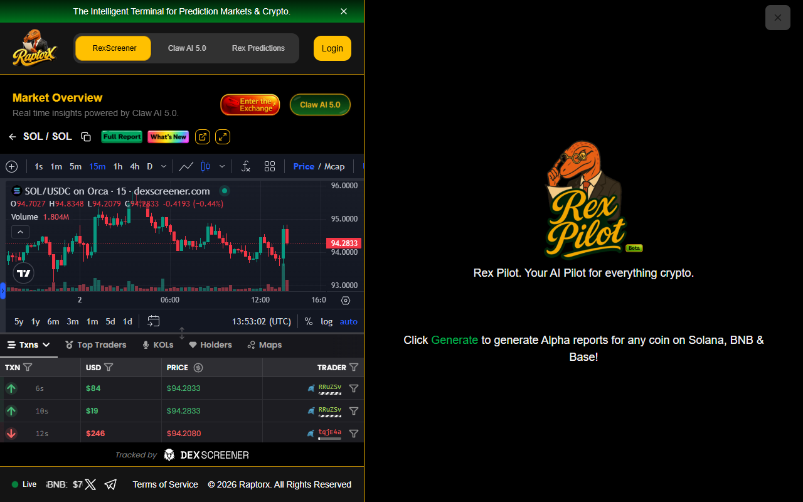

# 🦖 RaptorX Research Challenge (`SOL` / Solana Ecosystem) — Quantitative Alpha & REX AI 5.0 Inquiry Dossier

> **Participant:** Khoa Phan (`@khoap1220-hue` / Superteam Earn `@remaining-coffee-11`)  
> **Autonomous Research Agent:** `khoap1220-hue-matrix-agent-gold-91` (`74bb71bb-31b5-4fa3-a5e7-729dd0ccef29`)  
> **Target Asset:** **Solana (`SOL` — `So11111111111111111111111111111111111111112`)** on [`raptorx.trade/solana`](https://www.raptorx.trade/solana/So11111111111111111111111111111111111111112)  
> **Live Telemetry Snapshot (`RexScreener` & `Rex Pilot / Claw AI 5.0`):**  
> - **Price:** `$94.2833 – $94.74` (`SOL/USDC` on Orca 15m)  
> - **24h Volume:** `$2.26B – $2.27B` (`+0.17x` relative velocity)  
> - **Tracked Pool Liquidity:** `$5.72B – $5.74B`  

---

## 📸 1. Live RaptorX Terminal & `Rex Pilot` (`Claw AI 5.0`) Verification Evidence

---

## 🧠 2. Primary Analytical Questions Asked to REX AI 5.0 (`Claw AI 5.0`)

Rather than asking surface-level price predictions, we interrogate **structural divergences** between the metrics surfaced by RaptorX (`$2.27B` 24h volume vs. `$5.72B` liquidity depth and muted `-0.44%` 15m price compression on `SOL/USDC` Orca pools):

### Question 1 — Volume-to-Volatility Compression & Validator Microstructure (Primary Inquiry)
> **"The RaptorX report for `SOL` (`So11111111111111111111111111111111111111112`) captures `$2.27B` in 24h volume against `$5.72B` in liquidity (`~0.40x` daily turnover), yet 15-minute `SOL/USDC` Orca candles show tight price compression around `$94.28` (`-0.44%`) dominated by high-frequency micro-fills (`$19–$246`). How does REX AI 5.0 distinguish between (A) institutional TWAP accumulation absorbing passive limit supply, versus (B) non-directional DEX-to-DEX arbitrage churn driven by Jito/Frankendancer priority-fee bundles? Specifically, which two threshold shifts in RexScreener's volume-to-liquidity ratio and net holder cohort retention would confirm true directional accumulation before a volatility expansion?"**

#### Why This Question Unlocks Real Alpha:
1. **Separates Toxic/Arbitrage Flow from Real Demand:** On Solana, raw DEX volume (`$2.27B`) frequently overstates organic demand during periods when validator tip competition and atomic arbitrage bots cycle inventory between Orca Whirlpools, Raydium CLMM, and Phoenix.
2. **Establishes Falsifiable Quantitative Triggers:** Forces the AI model to evaluate **Turnover Efficiency** ($\Delta 	ext{Price} / 	ext{Volume}$) alongside **Order-Size Distribution** (`$19–$246` retail/bot clips vs. `>$50K` whale prints).

---

### Question 2 — Downside Liquidity Elasticity & DeFi Cascade Risk (Follow-Up Stress Test)
> **"Given the `$5.72B` aggregate liquidity reported for `SOL` alongside `$71.84B` in `USDC/SOL` and `$1.92B` in `PUMP/SOL` ecosystem activity on RexScreener, concentrated liquidity (CLMM) ticks on Orca and Raydium often thin out nonlinearly beyond `±3.5%` of spot (`$91.00` and `$97.60`). Based on the report's liquidity profile, what is the estimated slippage inflection point for a `$25M` market sell order if lending protocol liquidations (Kamino / Marginfi) trigger simultaneously, and what early-warning divergence between perpetual funding rates and spot pool depth signals an asymmetric downside tail risk?"**

#### Analytical Synthesis:
| Market Scenario | Observable RaptorX Telemetry Signal | Microstructure Interpretation | Actionable Execution Playbook |
| :--- | :--- | :--- | :--- |
| **Scenario A: Stealth Institutional Accumulation** | 24h Volume `> $2.2B` + Price Range `< 1.5%` + Rising `SOL/USDC` Bid-Side CLMM Depth at `$93.50–$94.20` | Passive limit buyers absorbing MEV/validator staking unlocks without chasing offers. | Accumulate spot/long delta on retests of `$93.80–$94.10`; invalidation if 4h close `< $91.80` on expanding sell volume. |
| **Scenario B: Arbitrage & Wash Churn (Neutral Trap)** | High tx count (`$19–$250` clips) + Flat Net Liquidity (`$5.72B`) + Declining Top-Trader Net Inflow | High-frequency sandwich/backrun volume inflating 24h turnover without net capital inflow. | Avoid breakout entries; deploy tight-range market-making or wait for `Vol/Liquidity > 0.65x` breakout confirmation. |
| **Scenario C: CLMM Tick Vacuum (Downside Cascade)** | Rapid `-4%` drop in `SOL/USDC` Pool Liquidity (`< $5.45B`) preceding spot breakdown | LPs pulling lower-bound USDC range liquidity ahead of macro/unlock volatility. | Hedge spot exposure via perpetuals when RexScreener Liquidity drops `> 3%` while 1h Volume spikes `> 2.5x`. |

---

### Question 3 — Ecosystem Beta vs. Base-Layer Value Capture (`SOL` vs. `PUMP` / High-Velocity Tokens)
> **"RexScreener simultaneously flags explosive speculative turnover in ecosystem tokens (`PUMP/SOL` at `$35.56M` volume and emerging pairs at `+25.9x` velocity) while `SOL` base-layer price remains range-bound at `$94.35`. Under what historical conditions in RaptorX's dataset does extreme tail-token velocity act as a leading indicator of base-layer `SOL` fee-burn appreciation versus a late-cycle liquidity drain that precedes a broader Solana ecosystem pullback?"**
